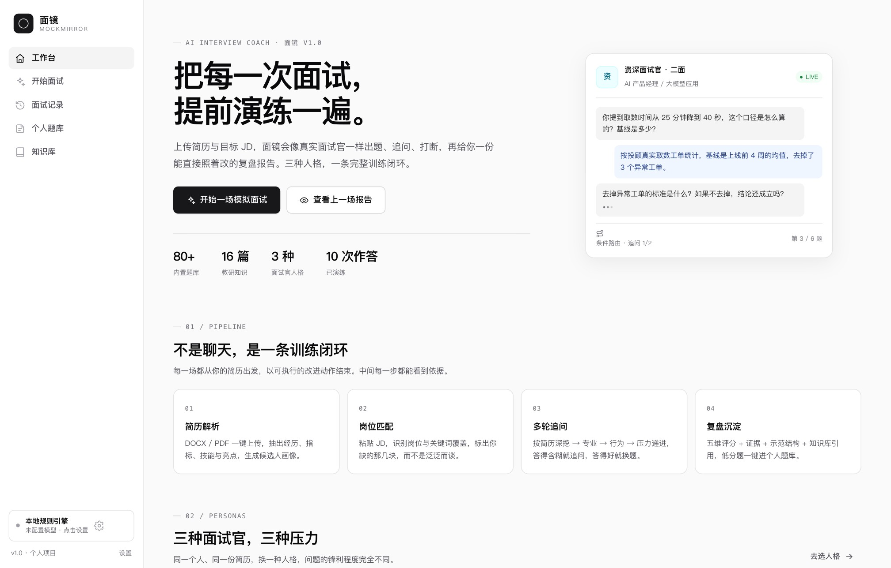
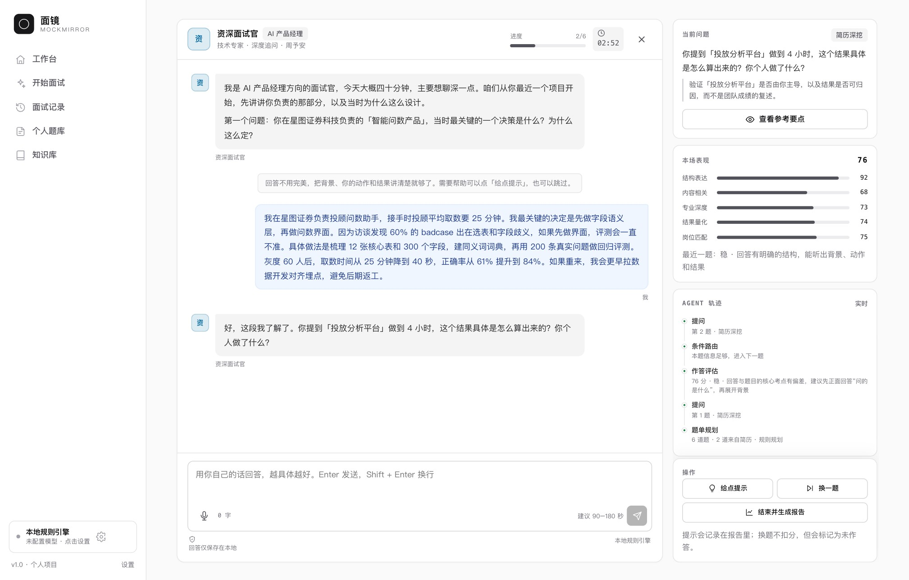
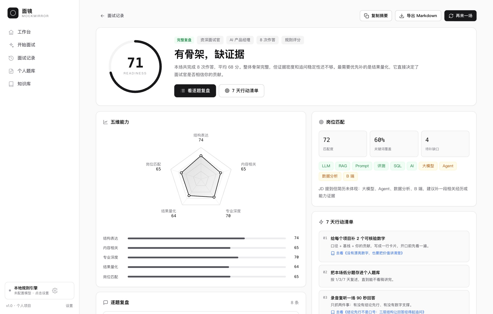
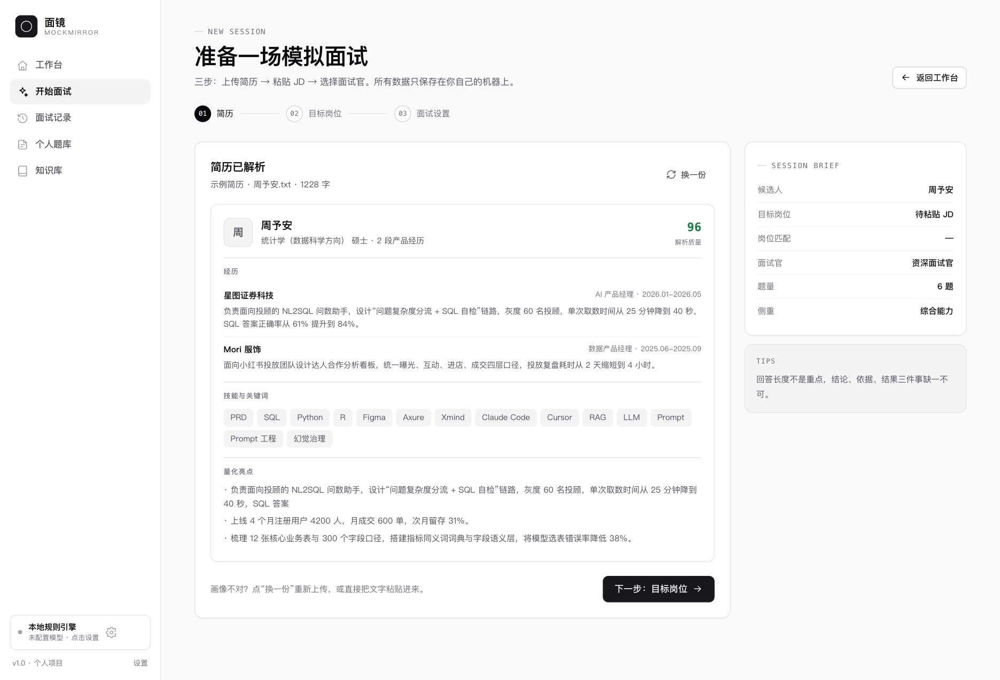
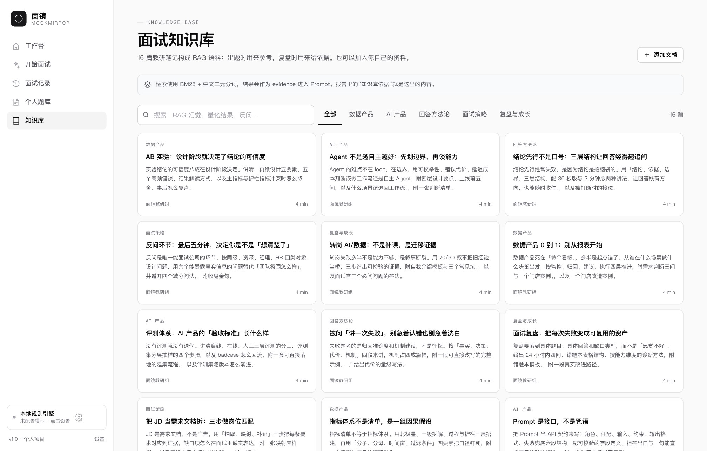
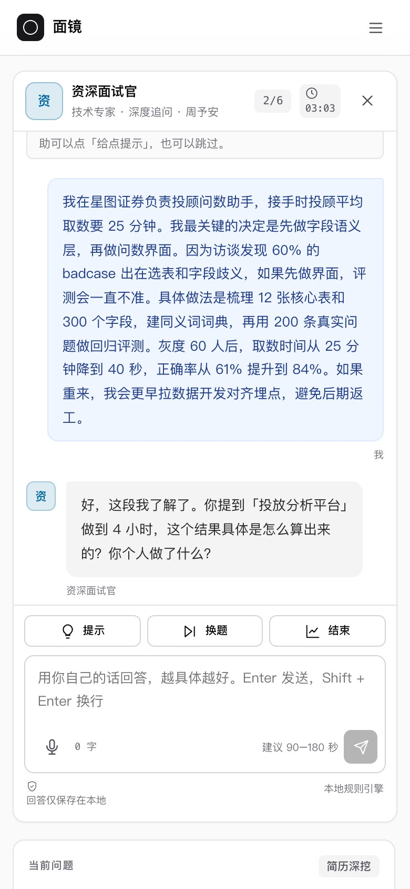

# 面镜 MockMirror

> 把每一次面试，提前演练一遍。

面镜是一个**面向 AI / 数据方向求职者的 AI 面试教练**：上传简历和目标 JD，它会生成一份只针对你的题单，用三种不同人格和你进行多轮模拟面试，结束后给出五维评分、逐题证据和可执行的改进动作。

这不是一个聊天壳子，而是一条完整的训练闭环：

```text
简历 & JD → 候选人画像 → 岗位匹配 → 题单规划 → 多轮追问 → 复盘报告 → 个人题库 → 再练
```



| 模拟面试 | 复盘报告 |
| --- | --- |
|  |  |

| 简历解析 | 知识库 |
| --- | --- |
|  |  |

移动端会自动折叠侧栏、把当前问题与快捷操作放到对话下方：

 

---

## 为什么重做

作者此前用过开源的面试 Demo，能跑通对话，但没法回答三个关键问题：

1. **题目跟我有什么关系？** 通用题库不会追问「你提到的 25 分钟是怎么算的」。
2. **分数为什么是这个数？** 只给一个总分，没有证据、没有口径、没有下一步。
3. **它到底在做什么？** 黑盒对话，看不到出题依据、检索结果和路由逻辑。

因此这个项目从零实现，重点放在**个性化、可解释、可复用**三件事上，而不是再做一个聊天界面。

---

## 功能

| 模块 | 做什么 | 关键设计 |
| --- | --- | --- |
| 简历解析 | PDF / DOCX / TXT / MD 上传或粘贴 | 规则解析出姓名、教育、经历、项目、指标、技能；DOCX 自研 ZIP + XML 解析，PDF 用 pdf.js 取文本 |
| 岗位匹配 | 粘贴 JD，识别岗位与关键词覆盖 | 岗位包 + 关键词映射，输出匹配度、已覆盖能力、缺口与建议 |
| 题单规划 | 生成 4–10 道只针对你的题 | 简历题 + 题库题混合；按「简历深挖 → 专业 → 行为 → 压力 → 反问」递进 |
| 模拟面试 | 多轮对话，支持追问、提示、换题、语音输入 | 三种人格；条件路由决定追问还是换题；每题最多 2 次追问 |
| 复盘报告 | 五维评分 + 逐题证据 + 示范结构 + 行动清单 | 规则评分可解释；配置模型后由 LLM 生成更自然的点评与改写 |
| 个人题库 | 收藏低分题，标记掌握度，写笔记 | 1 / 3 / 7 天复习节奏；支持导出 JSON |
| 知识库 | 16 篇教研笔记 + 自定义文档 | BM25 + 中文二元分词检索；报告与追问会引用知识库 |
| Agent 轨迹 | 实时展示「规划 → 提问 → 评估 → 路由」 | 显式状态机，节点耗时与路由原因都可见 |

### 三重面试官人格

| 人格 | 关注点 | 提问风格 |
| --- | --- | --- |
| 同级面试官 | 协作、学习能力、真实动机 | 轻松，会提示，顺着细节聊 |
| 资深面试官 | 专业深度、技术判断、方案取舍 | 连续追问三层，指出逻辑漏洞 |
| 直属经理 | 业务结果、优先级、跨团队推动 | 直接，会质疑数据和资源假设 |

---

## 快速开始

要求：**Node.js ≥ 20**，pnpm / npm 均可。

```bash
cd ai-interview-coach
pnpm install          # 或 npm install
pnpm start            # 默认 http://127.0.0.1:4318
```

打开 `http://127.0.0.1:4318`，点「开始一场模拟面试」→「用示例简历试试」→「用示例 JD」即可在 30 秒内跑完整个流程。

### 接入大模型（可选）

不配置模型也能完整使用：出题、追问、评分、报告全部由本地规则引擎完成，适合快速验证流程。

想要更自然的追问和点评，可在 **设置** 页填入任意 OpenAI 兼容接口：

- DeepSeek：`https://api.deepseek.com/v1`，`deepseek-chat`
- OpenAI：`https://api.openai.com/v1`，`gpt-4o-mini`
- OpenRouter、自建网关同理

也可以复制 `.env.example` 为 `.env`：

```bash
LLM_BASE_URL=https://api.deepseek.com/v1
LLM_API_KEY=sk-...
LLM_MODEL=deepseek-chat
```

成本参考：一场 6 题面试约 1.5 万 tokens，DeepSeek 约 ¥0.02–0.05。

> Key 只保存在本机 `data/store.json`（权限 600），不会下发到浏览器；接口只返回掩码。

---

## 使用流程

1. **解析简历**：拖入 PDF / DOCX，或直接粘贴文字。解析质量分低时会提示你调整排版。
2. **粘贴 JD**：自动识别岗位、关键词覆盖和缺口；也可以手动选岗位。
3. **选择面试官**：人格、题量（4–10）、侧重（综合 / 专业深挖 / 行为 / 压力）。
4. **开始面试**：回答后按 Enter 发送；卡住可以点「提示」，不想答可以「换一题」。
5. **查看报告**：五维雷达、逐题得分与风险、知识库依据、示范结构、7 天行动清单。
6. **沉淀题库**：把低分题加入个人题库，按 1 / 3 / 7 天复述。

---

## 技术栈与架构

- **后端**：Node.js 原生 HTTP，无 Web 框架、无数据库；JSON 文件持久化（原子写入）
- **前端**：原生 ES Modules + 自写 CSS 设计系统，**零构建**，刷新即生效
- **文档解析**：自研 DOCX 解析（ZIP central directory + `zlib.inflateRawSync` + OOXML）；PDF 使用 `pdfjs-dist`
- **检索**：BM25 + 中文 bigram 分词 + 英文词边界，内置 80 题 / 16 篇知识 / 6 个岗位包
- **编排**：显式状态机（节点 + 条件边），每次路由都写入 trace
- **模型**：OpenAI 兼容接口，支持 SSE 流式；失败自动降级到本地引擎
- **图表**：手写 SVG 雷达图 / 进度环，无图表库

```text
浏览器（原生 ESM）
   │  fetch / SSE
   ▼
Node HTTP API ── 状态机（parse → match → plan → ask → evaluate → route → report）
   │                 │
   │                 ├── RAG（BM25，知识库 + 题库）
   │                 ├── 本地规则引擎（零 Key 可用）
   │                 └── LLM（可选，流式）
   ▼
data/store.json（简历 / 会话 / 题库 / 设置）
```

更细的设计见：

- [产品需求文档（Word）](docs/面镜MockMirror-产品需求文档-v1.1.docx) · [Markdown 源稿](docs/PRD.md)
- [测试用例与执行报告（Excel）](docs/面镜MockMirror-测试用例与执行报告-v1.0.xlsx) · [测试报告](docs/TEST-REPORT.md)
- [架构说明](docs/ARCHITECTURE.md)
- [Prompt 设计](docs/PROMPTS.md)
- [演示脚本](docs/DEMO.md)

---

## 测试与验收

- **158 条用例**：功能验收 51 + 接口 55 + UI 30 + 后台/安全 8 + LLM/边界 14，全部通过。
- 发现 **6 个缺陷**（1 高 / 2 中 / 3 低），已全部修复并回归；无未关闭 P0/P1。
- 覆盖真实 DOCX/PDF 解析、SSE 流式、提示/跳过/报告、题库/知识库 CRUD、移动端、XSS、超大请求与模型降级。
- 明细见 [测试报告](docs/TEST-REPORT.md) 与 [测试用例 Excel](docs/面镜MockMirror-测试用例与执行报告-v1.0.xlsx)。

---

## 目录结构

```text
ai-interview-coach/
├── server/
│   ├── index.js              # HTTP 服务与 API 路由
│   ├── store.js              # 内容加载与 JSON 持久化
│   ├── parsers/              # DOCX / PDF / 文本解析
│   ├── profile.js            # 简历 → 结构化画像
│   ├── jd.js                 # JD → 岗位匹配
│   ├── rag.js                # BM25 检索
│   ├── llm.js                # OpenAI 兼容客户端（流式）
│   └── agent/
│       ├── graph.js          # 状态机与 trace
│       ├── conversation.js   # 会话编排
│       ├── local.js          # 本地出题 / 评分 / 报告
│       └── prompts.js        # Prompt 模板
├── public/                   # 零构建前端
│   ├── index.html
│   ├── css/app.css
│   └── js/                   # 路由、组件、页面、图表
├── content/                  # 题库、知识库、人格、岗位包
├── data/                     # 运行时数据（demo.json 除外，已 gitignore）
└── docs/                     # PRD、架构、Prompt、演示脚本
```

---

## 数据与隐私

- 简历、对话、报告、设置全部保存在本机 `data/store.json`，不上传第三方。
- 只有在**你主动配置模型**后，必要的文本才会发送到你填写的模型接口。
- 项目没有账号体系、没有埋点、没有外部字体和 CDN 请求。
- 上传文件限制 10MB；旧版 `.doc` 需另存为 `.docx`。

---

## 已知边界

- 本地规则引擎是启发式评分，能保证流程和解释性，但语义理解有限；想要更自然的追问请配置模型。
- 扫描版 PDF 没有文字层，无法解析，请改用 DOCX 或粘贴文本。
- 语音输入依赖浏览器 `SpeechRecognition`（Chrome / Edge），Safari 暂不支持。
- 单机单用户设计，没有并发写入锁；不适合直接暴露到公网多用户使用。

## Roadmap

- [ ] 面试过程中的实时打断与追问建议
- [ ] 多场趋势对比（同岗位、不同人格）
- [ ] 题库导出为 Anki / 飞书表格
- [ ] 面试录音回放与语速、口头禅分析
- [ ] 支持多用户与部署到 Vercel / Fly.io

---

## 作者

石浩田 · 香港城市大学统计学硕士 · AI / 数据产品方向

如果这个项目对你有帮助，欢迎提 Issue 或直接改造成你自己的版本。
