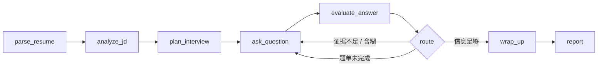

# 面镜 MockMirror · 架构说明

## 1. 设计目标

| 目标 | 做法 | 取舍 |
| --- | --- | --- |
| 无 Key 也能完整演示 | 本地规则引擎承担出题、追问、评分、报告 | 语义理解有限，必须在 UI 上明确标注「规则评分」 |
| 每一步可解释 | 显式状态机 + trace + 评分维度 + 知识库引用 | 比「一次 LLM 调用出结果」多写不少编排代码 |
| 快速迭代 | 零构建前端、无数据库、单进程 | 不适合多用户并发 |
| 可替换模型 | 只依赖 OpenAI 兼容协议 | 不支持厂商私有协议；Anthropic 需网关转换 |

非目标：实时语音面试、多人协作、公网 SaaS、简历代写。

## 2. 进程模型

```text
┌───────────────────────────── Node.js 单进程 ─────────────────────────────┐
│                                                                          │
│  HTTP Server (server/index.js)                                           │
│    ├── 静态文件 (public/)                                                 │
│    ├── /api/* 路由                                                        │
│    └── SSE (/turn)                                                       │
│                                                                          │
│  Content (启动时加载，只读)                                                │
│    content/personas.json · roles.json · questions/*.json · kb/*.json     │
│                                                                          │
│  Runtime (Neon mockmirror_state / data/store.json)                        │
│    resumes · sessions · bank · customKb · settings                       │
└──────────────────────────────────────────────────────────────────────────┘
```

- 启动时 `initStore()` 加载内容与用户数据；内容文件每次启动重新读取，便于改题库不改代码。
- 配置 `DATABASE_URL` 时，动态状态写入 Neon `mockmirror_state`（单行 JSONB）；没有配置时回退到 `data/store.json`，写操作使用 `tmp → rename` 原子替换，避免进程中断写坏 JSON。
- 每次写操作合并为当前状态快照，80ms 防抖后落库；`SIGTERM` 时会 flush。
- 没有登录态：单用户本地工具，所有数据属于当前机器。

## 3. 请求生命周期

### 3.1 解析简历

```text
POST /api/resume/parse
  → 校验大小/格式
  → DOCX: ZIP central directory → inflateRaw → OOXML → 段落/表格文本
  → PDF : pdfjs-dist getTextContent（扫描件判定失败）
  → cleanText（去零宽、统一换行、压缩空白）
  → parseResume()
      splitSections（按「教育背景 / 实习经历 / 项目经历…」切段）
      extractContacts / parseEducation / parseEntries / parseSkills / buildHighlights
      qualityOf（联系方式、段落数、指标数、技能数）
  → 存入 store.resumes
```

不调用 LLM：解析必须是确定性的，且失败时能给出可复现的原因（排版、扫描件、字段缺失）。

### 3.2 创建面试

```text
POST /api/sessions
  → analyzeJD（岗位包匹配 + 关键词覆盖）
  → runStartGraph:
       plan_interview → ask_question → END
  → 保存 plan / pending / 开场消息 / trace
```

`plan_interview` 优先用 LLM 规划；失败、超时或 JSON 不合法时回退到本地题单，并在 `plan.source` 标记 `llm | local`。

### 3.3 单轮作答

```text
POST /api/sessions/:id/turn (SSE)
  → 追加候选人消息
  → runTurnGraph:
       evaluate_answer → route → (ask_question | wrap_up) → END
  → 流式生成面试官回复（LLM 或本地）
  → 并行：LLM 单题评估（失败用本地评分）
  → 更新会话、记忆摘要、指标，持久化
```

SSE 事件顺序：

| 事件 | 内容 | 用途 |
| --- | --- | --- |
| `meta` | 本轮决策（probe / next / finish） | 前端切换状态 |
| `delta` | 增量文本 | 打字机效果 |
| `evaluation` | 单题完整评分 | 右侧评分卡 |
| `state` | 最新会话快照 | 进度、下一题、trace |
| `error` | 错误信息 | 提示并允许重试 |

## 4. 状态机



| 节点 | 输入 | 输出 | 失败策略 |
| --- | --- | --- | --- |
| `parse_resume` | 文档文本 | profile | 抛错，提示换格式或粘贴 |
| `analyze_jd` | JD + profile | 岗位、覆盖率、缺口 | 关键词为空时用通用岗位包 |
| `plan_interview` | profile + JD + 配置 | rounds[] | LLM 失败回退本地规划 |
| `ask_question` | 当前题 / 追问计数 | 下一题文本 | 无题可出时收尾 |
| `evaluate_answer` | 题目 + 回答 | 五维分数 + 证据 | LLM 失败回退本地评分 |
| `route` | 评分 + 回答特征 | probe / next / finish | 默认 next，避免死循环 |
| `wrap_up` | 会话 | 结束状态 | 直接结束 |

### 条件边规则

| 条件 | 路由 | 原因 |
| --- | --- | --- |
| 回答 < 130 字 | probe | 信息量不足 |
| 总分 < 64 | probe | 可信度不足 |
| 结果量化 < 58 | probe | 缺少口径 / 数字 |
| 专业深度 < 60 | probe | 停留在「做了什么」 |
| 出现「大概 / 差不多 / 记不清」 | probe | 记忆模糊，需要确认 |
| 明确说「不知道 / 没做过」 | next | 不重复施压 |
| 本题追问次数 ≥ 2 | next | 防止无限追问 |
| 整场追问次数 ≥ max(1, 题量/2) | next | 控制总时长，保证主问题覆盖 |
| 已是最后一题 | finish | 收尾 |

所有判断都写入 `session.trace`，前端「Agent 轨迹」实时展示。

## 5. 题单规划

- 阶段序列由侧重决定：`balanced / deep / behavior / pressure` 四套模板。
- 「简历深挖」优先使用从简历指标生成的定制题：
  - 关键决策题
  - 指标口径题
  - 复盘题
  - 协作冲突题
- 其余阶段从 80 题题库中按「岗位匹配度 + 人格匹配 + JD 关键词重合 + 难度」排序选取，去重后按阶段插入。
- LLM 规划只允许从候选池 `refId` 中选择或改写题干，禁止编造经历；生成后校验题量、阶段、字段，缺题用本地题补齐。

## 6. 评估体系

### 6.1 五维与权重

| 维度 | 权重 | 含义 | 本地信号 |
| --- | --- | --- | --- |
| structure | 0.20 | 背景 / 目标 / 动作 / 结果 / 复盘 | 结构词、连接词、长度 |
| relevance | 0.25 | 是否回答问题、覆盖考点 | 题干与回答的 bigram 重合、要点覆盖、证据补偿 |
| depth | 0.25 | 判断依据、权衡、细节 | 长度、技术词、因果词、领域词 |
| impact | 0.20 | 数字、口径、基线、个人贡献 | 数字密度、结果动词、对比词 |
| fit | 0.10 | 岗位能力体现 | 简历技能命中、JD 关键词、第一人称比例 |

总分 = 加权和。报告准备度 = 总分均值 × 0.92 + 完成题量奖励（最多 8 分），少于 4 题标记为「初评」。

### 6.2 题型感知

同一套评分不能套所有问题：

- **story**（讲讲项目 / 经历）：要求 STAR 结构，短回答扣分明显。
- **explain**（口径 / 基线 / 为什么）：允许 60–120 字的精确回答，不强制 STAR，更看重口径与证据。
- **judge**（如果资源减半 / 怎么取舍）：看重权衡与优先级。
- **probe**（追问）：结构分给保底，深度与相关性权重更高。

### 6.3 LLM 评估

- 温度 0.3，`response_format=json_object`（失败自动去掉重试）。
- 只使用简历中已有的经历和数字，禁止编造；信息不足时输出带占位符的示范结构。
- LLM 分数会按同一套权重重新计算总分，避免模型直接给一个不可解释的总分。
- LLM 失败 → 本地评分，并在会话 `lastError` 标记，前端提示「已切换本地兜底」。

## 7. RAG

### 7.1 索引

文档来源：16 篇知识库 + 80 道题 + 6 个岗位包。

分词：

- 英文：`[a-z][a-z0-9+#.]{1,}`，保留 `LLM`、`RAG`、`A/B` 等术语
- 数字：两位以上数字
- 中文：连续汉字段的 **bigram**，长度 ≤5 的整词也入索引
- 停用词：常见虚词、面试场景高频词

打分：BM25，`k1 = 1.35`，`b = 0.72`，查询词频上限 2。

### 7.2 使用位置

| 场景 | 查询 | 返回 |
| --- | --- | --- |
| 出题 | JD + 简历关键词 | 候选题目 |
| 单题提示 | 题干 + 考察点 | 知识库要点 |
| 复盘 | 题目 + 风险描述 | 2 条引用（标题 + 摘要） |

所有引用都带 `id / title / snippet`，前端可点开原文。

### 7.3 自定义文档

用户添加的 Markdown 进入 `customKb`，保存后 `invalidateIndex()`，下次检索重建索引。内置文档不可删除。

## 8. 上下文与记忆

- 每轮只取最近 **8 条**消息进入 Prompt，控制 token。
- 更早内容压缩为 `memory.summary`：已覆盖的题目主题 + 最近 4 次回答的前 48 字。
- 候选人画像用 `condenseProfile()` 压到 1800 字，JD 压到 600 字。
- 系统提示固定包含：人格、规则、画像、JD；不放大段原始简历。
- 单题评估只带题目、要点、回答，不带全量历史，降低成本与串扰。

## 9. LLM 客户端

- 只实现 `/chat/completions`，兼容 DeepSeek / OpenAI / OpenRouter / 自建网关。
- `chat()` 非流式；`streamChat()` 解析 SSE `data:` 帧，忽略 keep-alive 与 `[DONE]`。
- 90 秒超时；401 / 404 / 429 / 5xx 转成中文可操作提示。
- JSON 输出统一走 `extractJson()`：兼容 ```json 代码块、前后解释文字。
- API Key 只存在服务端，`publicSettings()` 只返回 `hasKey` 与末四位。

## 10. 数据模型

```jsonc
// session
{
  "id": "uuid",
  "status": "active | completed | finished",
  "profile": { "name": "...", "experience": [], "projects": [], "skills": [], "highlights": [] },
  "jd": { "text": "...", "analysis": { "roleName": "...", "matchScore": 72, "matched": [], "missing": [] } },
  "config": { "persona": "senior", "rounds": 6, "focus": "balanced" },
  "plan": { "rounds": [{ "text": "...", "stage": "简历深挖", "intent": "...", "answerPoints": [], "followUps": [] }], "cursor": 0 },
  "pending": { "question": {}, "index": 0, "followUpIndex": 0, "kind": "main | probe" },
  "messages": [{ "role": "interviewer | candidate | system", "kind": "question | answer | hint | skip", "content": "..." }],
  "evaluations": [{ "question": {}, "answer": "...", "scores": { "structure": 80 }, "total": 76, "strengths": [], "risks": [], "rewrite": "..." }],
  "trace": [{ "node": "route", "label": "条件路由", "detail": "...", "ms": 3, "tone": "ok" }],
  "report": { "readiness": 72, "dimensionScores": {}, "strengths": [], "risks": [], "actions": [] }
}
```

其他实体：`resumes`（原文 + 画像）、`bank`（题目 + 掌握度 + 笔记）、`customKb`、`settings`。

## 11. API

| 方法 | 路径 | 说明 |
| --- | --- | --- |
| GET | `/api/bootstrap` | 人格、岗位、统计、设置、节点元信息 |
| GET | `/api/demo` | 示例简历与 JD |
| POST | `/api/resume/parse` | base64 文件或文本 → 画像 |
| POST | `/api/jd/analyze` | JD → 匹配分析 |
| POST | `/api/sessions` | 创建面试 |
| GET | `/api/sessions` | 历史列表 |
| GET | `/api/sessions/:id` | 会话详情 |
| POST | `/api/sessions/:id/turn` | SSE 单轮作答 |
| POST | `/api/sessions/:id/hint` | 提示 |
| POST | `/api/sessions/:id/skip` | 跳过 |
| POST | `/api/sessions/:id/report` | 生成报告 |
| DELETE | `/api/sessions/:id` | 删除 |
| GET/POST | `/api/bank` | 题库 |
| PATCH/DELETE | `/api/bank/:id` | 掌握度 / 笔记 / 删除 |
| GET/POST | `/api/kb` | 知识库 / 检索（`?q=`） |
| GET/DELETE | `/api/kb/:id` | 详情 / 删除自定义文档 |
| GET/PUT | `/api/settings` | 模型设置（Key 不回传） |
| POST | `/api/settings/test` | 连通性测试 |

## 12. 安全与隐私

- 文件大小上限 12MB（JSON body），简历文本上限 3 万字。
- 静态文件做路径规范化，拒绝越出 `public/`。
- 不执行上传内容；Markdown 渲染先转义再格式化。
- API Key 服务端存储、掩码返回；日志不打印 Key。
- 没有外部 CDN / 字体 / 埋点请求。

## 13. 性能与成本

| 操作 | 本地模式 | LLM 模式 |
| --- | --- | --- |
| 解析简历 | < 300ms（含 PDF） | 同左（解析不调用 LLM） |
| 创建面试 | < 50ms | 2–6s（题单规划） |
| 单轮回复 | ~0.5s（模拟流式） | 1–4s（流式首字 < 1s） |
| 单题评估 | 同步 < 5ms | 1–3s（与回复并行） |
| 报告 | < 20ms | 3–8s |

一场 6 题约 1.5 万 tokens；本地模式零成本。

## 14. 验证方式

- 真实简历（DOCX + PDF）解析回归：教育 2 段、实习 3 段、项目 2 个、指标 6 条。
- 端到端：示例简历 → JD → 建场 → 3 轮作答 → 报告 → 题库。
- 浏览器 QA：Puppeteer 跑通桌面 1440 与移动 390，无 console error、无横向溢出。
- 模型链路：本地 mock OpenAI 服务验证流式、JSON、超时与降级。
- 评分检查：强回答 / 短回答 / 跑题回答 / 追问回答四类样本，人工核对分差方向。

## 15. 已知限制

- 规则评分对同义表达不敏感，只能作为兜底，不应替代人工判断。
- BM25 没有向量语义召回，行业新词可能漏检。
- 持久化层是单行 JSON 文档（文件或 Neon JSONB），没有按实体加锁；多实例并发写会以后写覆盖先写。
- 语音输入依赖浏览器能力，不做录音存储。
